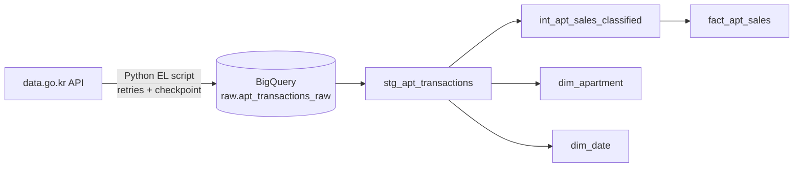

# Seoul Apartment Sales: an ELT pipeline with BigQuery and dbt

**[Live dbt docs](https://<your-username>.github.io/<repo-name>/)**: model lineage, column descriptions and test coverage.

An end-to-end analytics engineering project on public Korean real-estate data. A Python extractor loads apartment sale records from the government open-data API into BigQuery, and dbt turns them into a tested star schema.

**Stack:** Python · BigQuery · dbt · Git
**Source:** Ministry of Land, Infrastructure and Transport (MOLIT) apartment sale transactions, "detailed" endpoint (`RTMSDataSvcAptTradeDev`), via [data.go.kr](https://www.data.go.kr)
**Scope:** 5 Seoul districts, January 2023 to October 2026, 61,950 records, 2,264 apartment complexes

| District code | District |
|---|---|
| 11500 | Gangseo-gu |
| 11620 | Gwanak-gu |
| 11680 | Gangnam-gu |
| 11710 | Songpa-gu |
| 11740 | Gangdong-gu |

## Architecture



EL and T are deliberately separate: extraction and loading live in `ingestion/` (Python), all transformation lives in `dbt/` (SQL). The raw table is never modified by dbt.

| Layer | Model | Materialization | Purpose |
|---|---|---|---|
| raw | `raw.apt_transactions_raw` | table (loaded by Python) | Untouched API output, every column STRING |
| staging | `stg_apt_transactions` | view | Rename, trim, cast, parse dates, build keys |
| intermediate | `int_apt_sales_classified` | view | Business classification (bulk-deal flag) |
| marts | `fact_apt_sales`, `dim_apartment`, `dim_date` | table | Star schema |

## Modeling decisions

- **Grain: one row per reported sale record, not per apartment unit.** The source publishes no unit number, so two sales on the same floor with the same area, price and day are indistinguishable.
- **Keys.** `deal_group_key` is a hash of immutable fields only (complex, dong, floor, area, deal date, price). `transaction_id` is the group key plus an occurrence counter. It is unique by construction, so its test guards against join fan-out. It does not prove the records are distinct sales.
- **Cancelled deals are flagged, not deleted** (`is_cancelled`), so the logic stays visible. Analyses filter them.
- **Bulk deals are flagged** (`is_bulk_deal`): an active record that shares its full key with at least 8 other active records (`bulk_deal_min_group_size`). Group sizes cluster at 2 to 5 (521 groups) and 8 to 12 (28 groups), with none at 6 or 7. The threshold is empirical, derived from these five districts, and should be revisited if the scope grows.
- **Price unit.** The API publishes prices in units of 10,000 KRW. The fact table keeps that column and adds `deal_amount_krw` and `price_per_m2_krw`.
- **Buyer and seller type** are `not_reported` for all of 2023. The API does not publish them before 2024-01.

## Data quality findings

Everything below was found by querying the data, not assumed.

| Finding | Evidence | Handling |
|---|---|---|
| ~5% of records are cancelled | 3,068 of 61,950 | `is_cancelled` flag |
| No unit identifier in the source | See grain above | Record-level grain, documented |
| Records sharing the same business key | 549 groups, 1,391 rows (2.2%) | See below |
| Buyer and seller type missing for all of 2023 | 10,051 of 10,051 rows null in 2023; 0 null from 2024-01 | `not_reported` in the fact table |
| Dong (building) is blank for many records | 12.8% to 14.7% of rows in 2023 to 2025, 33.5% in 2026 | Kept as null; cause of the 2026 rise unknown |
| Latest months are incomplete | Recent monthly counts are far below typical months | Excluded from trend queries; likely a reporting lag |

**The 549 duplicate-key groups:**

- 214 are a cancelled record plus its re-reported twin. The cancel flag handles these.
- 20 differ in registration date or agent location, so they are probably separate deals.
- 315 are identical in every field available. They are either distinct units that look the same or double-reported records, and the data cannot tell which. A worst-case overcount of active records is roughly 630 (about 1% of rows).
- 28 large groups (269 rows) are almost certainly bulk transfers, such as one buyer taking several identical units on the same day. These are flagged with `is_bulk_deal`.

## Tests

- Generic: `not_null`, `unique`, `accepted_values` (district codes), `relationships` (fact to dimensions).
- Singular: `assert_staging_sanity` (dates parse, request district matches the record's district) and `assert_apartment_attributes_stable` (each complex has exactly one name, build year and neighborhood, which protects the `any_value` in `dim_apartment`).

## Example analysis

Median price per m² (KRW, millions) by district, single months, excluding cancelled and bulk deals:

| District | Jan 2023 | Aug 2026 |
|---|---|---|
| Gangnam | 24.2 | 33.4 |
| Songpa | 20.3 | 24.7 |
| Gangdong | 13.5 | 17.2 |
| Gangseo | 11.1 | 13.4 |
| Gwanak | 9.3 | 11.1 |

This is **not a price index**. A raw median mixes complexes, sizes and ages, and single-month medians on a few dozen sales are noisy. Volume also moves a lot: Gangnam recorded 204, 594, 842 and then 106 sales in January to April 2025.

```sql
select d.year_month, a.district_code, count(*) as n_sales,
       approx_quantiles(f.price_per_m2_krw, 2)[offset(1)] as median_price_per_m2_krw
from fact_apt_sales f
join dim_apartment a on a.apartment_seq = f.apartment_seq
join dim_date d on d.date_day = f.deal_date
where not f.is_cancelled and not f.is_bulk_deal
group by 1, 2
```

## Known limitations

- Five districts only. District codes are not yet joined to names in the models.
- The load is a full refresh (`WRITE_TRUNCATE`); there are no incremental models.
- Runs are manual: no orchestration and no CI yet.
- No quality-adjusted price index; medians only.
- Source gaps (no unit number, partial buyer and seller type, missing dong) cannot be fixed downstream.

## Reproduce

1. Request an API key for the apartment sales detail API on data.go.kr and export the Decoding key: `export DATA_GO_KR_KEY=...`
2. Authenticate to Google Cloud: `gcloud auth application-default login`, then create the dataset: `bq mk --location=asia-northeast3 raw`
3. Run the extractor: `python ingestion/el_script.py` (installs: `requests pandas google-cloud-bigquery db-dtypes pyarrow`). It checkpoints to a local CSV and resumes after a failure.
4. Configure the `bigquery` profile in `~/.dbt/profiles.yml` (method `oauth`, location `asia-northeast3`), then run `cd dbt && dbt build`.

## How AI was used

Claude (Anthropic) acted as a pair-programmer and reviewer: it drafted the extractor, the dbt models and the tests. I ran everything, checked it against the data and the API specification, and made the modeling decisions. Problems found along the way:

| AI draft or assumption | What I found | Fix |
|---|---|---|
| Extractor had no pagination and no check of the API's result code | Found when comparing the script to the API documentation | Added a pagination loop and error handling |
| Whole run held in memory | A network timeout after about 70 combinations lost all fetched data | Added retries with backoff and a checkpoint file |
| Setup instructions omitted a dependency | `pyarrow` was missing, so the load failed | Added to the install list |
| Hypothesis: buyer and seller type are only filled for direct deals | Contradicted by the data: missing for all of 2023, present for both deal types afterwards | Treated as a coverage gap by period |
| Single `transaction_key` assumed unique | 549 groups share a key | Group key plus occurrence counter; limitation documented |
| Duplicate diagnostic compared registration dates | Cancelled records have no registration date, so the comparison was confounded | Re-read the results with the cancel flag separated |

<!-- Edit this section so it matches exactly what you did and decided yourself. -->